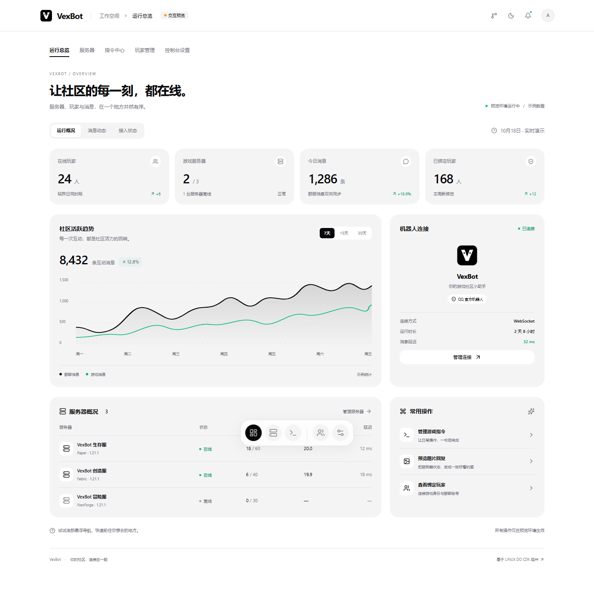

# VexBot WebUI 交互预览

面向服主和团队成员的启动、功能与故障处理见[新版控制台使用指南](../docs/webui-preview.md)。5800 是 Bot 内置面板，5801 是此独立控制台，8089 是社区官网的默认本机预览端口。

基于 [linux-do/cdk](https://github.com/linux-do/cdk) 的前端组件和设计样式制作的 VexBot 管理界面。玩家管理与网站详细设置已连接 VexBot 后台；运行总览、服务器、指令中心和其余预览选项使用本地示例数据，可体验导航、主题和表单交互。

整个控制台统一使用现有管理员用户名和密码登录，登录后各页面共享同一个会话，玩家管理按后台权限读取和修改真实玩家数据。登录令牌仅保存在当前页面内存，刷新需重新登录；切换页面不重复登录。右上角可随时退出，登录失效时整个控制台返回登录页。其他演示页面的操作只影响预览状态。

## 本地运行

先启动仓库根目录的 VexBot 主程序（默认 `5800`），再在本目录执行：

```powershell
npm ci
npm run dev
```

打开 <http://127.0.0.1:5801/>。已在 Node.js 24 验证；安装前端依赖需要联网。

构建并查看构建后的页面：

```powershell
npm run build
npm run preview
```

构建预览同样使用 `5801` 端口；请先停止开发服务器，再运行 `npm run preview`。

本目录运行 React 前端，玩家管理和网站设置通过同源代理连接已有 VexBot 后台；不需要 CDK 的 Go 后端、Redis、OAuth 或第三方账号。默认目标为 `http://127.0.0.1:5800`，可复制 `.env.example` 为 `.env.local` 设置 `VEXBOT_BACKEND_URL`，修改后重新启动前端服务。开发与构建预览均支持此代理。

代理地址只填后台来源，例如 `http://127.0.0.1:5800`；不要附带 `/api`、`/api/v1`、账号密码或查询参数。只复制 `dist/` 到静态服务器不会自动提供该代理，须另行配置 `/api` 转发。

## 玩家管理

进入控制台时登录现有管理员账号，再打开「玩家管理」，无需额外登录。服主或拥有 `players.manage` 权限的账号可以管理玩家；无该权限的账号会看到权限说明。首次尚未设置服主账号时，先打开登录页提供的正式控制台入口完成账号设置。

可查看、搜索和筛选真实档案，新增玩家、编辑归属地与备注、绑定或解绑 QQ / 官机身份，以及删除本地档案。删除和解绑在提交前需确认；档案编辑携带版本号，遇到并发修改会保留草稿并提示重新核对。

游戏内操作支持踢出、永久封禁、解除封禁和白名单增删。只能选择服务器当前上报且可管理的玩家，离线或旧版插件不提供操作入口。提交后显示等待游戏端确认，收到插件回执后才显示执行结果。页面退出或注销后停止轮询，网络中断不会自动重复提交操作。

## 网站详细设置

服主登录后进入「控制台设置」顶部的「网站详细设置」。选择「自定义网站」可填写网站地址与 Bot API 地址，并设置玩家信息、服务器状态和网站密码登录三个公开 API 权限；保存后由后台授权网站来源，无需填写管理令牌或额外 API 密钥。选择「VexBot 官网」还可编辑标题、副标题、社区介绍、规则、服务器地址、群聊链接、主色、辅助色、主题和网格背景。

「不接入官网」保留已保存的地址、内容与外观；公开 API 权限仍由各自开关控制。网站地址须为 HTTP(S)，Bot API 地址可填写公开的 `/api/v1` 地址，或留空使用官网同源 `/api/v1`。设置独立保存到现有后台，与页面下方仅存浏览器的预览偏好分开。非服主账号会看到权限说明，不读取网站配置。

独立官网部署建议明确填写实际公开 API 地址。留空会保持空值，并禁用 `config.json` 下载；此时「检查 API」使用当前控制台的代理，只能确认管理浏览器访问情况。官网同源 `/api/v1` 还需要在官网服务器配置转发，不会由本控制台代为部署。

支持下载接入指南、SDK 和已保存 API 地址对应的 `config.json`；「VexBot 官网」模式可下载后台已有的官网项目包，附件尚未部署时会显示后台错误。保存后可从浏览器检查公开 API，检查不会携带控制台凭据；跨域、HTTPS 和网络限制会影响检查结果。

未保存草稿在切页后保留。版本冲突或保存结果未确认时停止继续提交，可显式载入最新版本并仅保留自己改过的字段；重新载入或撤销草稿前提供应用内确认。

## 效果与验证

支持运行总览、服务器、指令中心、玩家管理和控制台设置。玩家管理与网站设置请求真实后台 API；其余选项仍为演示。演示服务器和指令修改在本次页面会话内保留；主题与预览设置保存在当前浏览器。

页面切换、卡片依次入场、统计数字计数、趋势线绘制、导航滑块、服务器筛选和悬浮导航带有动画。右上角的「动画」按钮可随时开关所有动效，选择会保存在当前浏览器，刷新与切页后保持生效；关闭时「重播动画」按钮停用。未手动选择时跟随系统减少动态效果设置，手动开启或关闭后按所选状态运行。

右上角的「背景」可切换纯净、雾蓝、薄荷、暖砂和点阵五种预设，支持深浅色主题。选择即时生效并保存在当前浏览器，切页和刷新后保留；所有背景均由本地 CSS 绘制，无需加载外部图片。

已通过 TypeScript 检查、生产构建及 Edge 浏览器交互检查，覆盖搜索、筛选、新建与重复标识验证、回复图片、设置保存和撤销、手机悬浮导航。1440px 桌面与 390px 手机均无页面异常或横向溢出。

真实玩家管理另使用独立数据库和真实后台接口验证了登录与权限、分页、档案新增删除、备注保存及版本冲突、QQ / 官机绑定解绑、指定服务器操作及插件回执、异常响应使用原请求编号重试，以及退出与过期会话的数据清理。320px 和 390px 手机列表及弹窗均无页面横向溢出；测试未修改现有玩家数据。

统一登录已验证全部五个页面的未登录拦截、切页共享会话、任意页面退出及后台会话撤销、权限不足账号的隔离、在非玩家页检测登录失效，以及开发环境 StrictMode 首次直达玩家页。登录前后均可使用主题、背景与动画设置，320px 和 390px 手机登录及顶部退出入口无溢出。

网站设置通过独立后台的真实接口和 Edge 浏览器验证：三种接入方式、公开权限、内容与外观保存回读、刷新、草稿撤销、版本冲突合并、无权限与过期会话、接入文件下载，以及不携带管理凭据的公开 API 检查。成功响应格式异常或提交后切页中断时，会保留草稿并要求核对保存结果。320px / 390px 页面无横向溢出；本机只做读取与界面检查，现有网站配置保持不变。

[网站设置深色效果](screenshots/website-settings-dark.png) · [网站设置浅色效果](screenshots/website-settings-light.png)

全控制台下拉栏使用统一组件，覆盖玩家状态、服务器筛选、每页数量、玩家绑定服务器和网站接入方式。触发器和展开菜单统一圆角、阴影与选中勾选，支持深浅主题、键盘选择、输入检索、滚动及手机屏幕边缘避让；动效跟随全局动画开关。已验证空选项重置、必填绑定、真实筛选与绑定请求、弹窗内 Escape 和焦点恢复，以及 320px / 390px 手机布局。

[深色下拉效果](screenshots/select-dark.png) · [浅色下拉效果](screenshots/select-light.png)

弹窗、表格、文本框与滚动区域统一使用细圆角滚动条，轨道透明、无上下箭头，滑块随深浅主题配色并在悬停与拖动时增强显示。保留键盘、滚轮与触摸滚动，系统高对比模式采用系统颜色。已在 Edge 实测弹窗滚轮、原生滑块拖动、手机底部操作和表格横向滚动；导航及组件内部原有的隐藏轨道保持隐藏。

[深色滚动条](screenshots/scrollbar-dark.png) · [浅色滚动条](screenshots/scrollbar-light.png)



[深色总览](screenshots/overview-dark.png) · [手机效果](screenshots/overview-mobile.png)

[雾蓝背景](screenshots/background-mist-light.png) · [深色背景](screenshots/background-mist-dark.png) · [手机背景选择器](screenshots/background-picker-mobile.png)

## 复用范围与许可

参考版本：[linux-do/cdk @ 6fb394a3d2d53796ef5d27b85994dd7b3b78fe2b](https://github.com/linux-do/cdk/tree/6fb394a3d2d53796ef5d27b85994dd7b3b78fe2b)。复用了该版本的 `frontend/components/ui/` 基础组件（包括 `floating-dock.tsx`）、`frontend/lib/utils.ts` 工具，以及 `frontend/app/globals.css` 中的主题变量和基础样式；具体保留的组件见本示例 `src/` 目录。

适配包括：将 Next.js 应用环境换为独立前端预览，使用 VexBot 品牌与机器人管理示例数据，替换业务导航与事件，调整导入路径，并补充适合预览的响应式布局和交互。没有接入 CDK 的兑换、支付、用户认证或其他后端业务。

这些复用部分保持原 MIT 许可，完整版权和许可声明位于 [third-party/linux-do-cdk-LICENSE.txt](third-party/linux-do-cdk-LICENSE.txt)。本项目新编写的 VexBot 页面和适配代码遵循仓库根目录的 [GNU AGPL-3.0 许可](../LICENSE)。各 npm 依赖遵循各自的许可。

本目录独立于正式 Bot 与官网部署包。构建输出包含原始许可和 npm 依赖许可清单。
